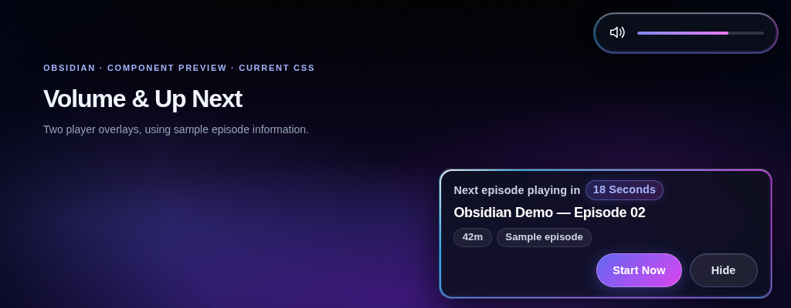
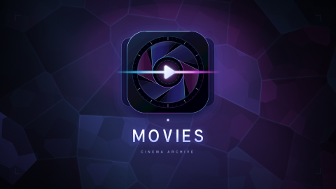
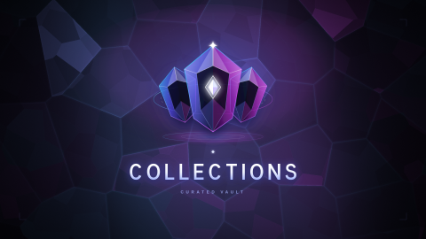

<div align="center">
  
  <h1>Obsidian</h1>
  <p>Dark glass Custom CSS theme for Jellyfin Web 12.2+ and Jellyfin Media Player, with matching library covers.</p>

  [](https://github.com/McEveritts/Obsidian/actions/workflows/ci.yml)
  [](./LICENSE)

  **[Install](#install) · [Playback controls](#playback-controls) · [Library covers](#library-covers) · [Presets](./docs/presets.md) · [Gallery](./docs/gallery.md)**
</div>

[](./docs/screenshots/03-desktop-library-grid.png)

## Install

Paste this at the top of **Dashboard → Branding → Custom CSS** (under General on some versions), above any other CSS rules:

```css
@import url("https://cdn.jsdelivr.net/gh/McEveritts/Obsidian@main/obsidian.css");
```

Save and reload (hard refresh with **Ctrl + F5** or **Cmd + Shift + R** if the old theme sticks).

If you'd rather not use a CDN, open [`obsidian.css`](./obsidian.css), click **Raw**, and paste the file directly. It uses system fonts and inline SVG textures with no external font or image requests. To pin a specific version instead of tracking `main`, replace `@main` with a commit SHA.

More install options, updates, and troubleshooting: [Getting started](./docs/getting-started.md#install-the-theme).

## Playback controls

Floating glass dock for the timeline, chapters, transport, audio/subtitles, volume, and settings:

[](./docs/screenshots/playback-controls-preview.png)

*Component preview rendered from `obsidian.css` with sample controls.*

<details>
<summary><b>Volume pill and Up Next overlay</b></summary>

[](./docs/screenshots/playback-overlays-preview.png)

</details>

## Library covers

Six optional 1920 × 1080 PNG covers. Click any cover to open and download the full-size image.

| Movies | Shows | Live TV |
| :---: | :---: | :---: |
| [](./assets/covers/movies.png) | [](./assets/covers/tv.png) | [](./assets/covers/live-tv.png) |

| Collections | Music | Playlists |
| :---: | :---: | :---: |
| [](./assets/covers/collections.png) | [](./assets/covers/music.png) | [](./assets/covers/playlists.png) |

[All covers](./assets/covers/README.md) · [How to upload covers](./docs/getting-started.md#add-the-matching-covers)

## Customization

Append a snippet from [Presets](./docs/presets.md) after the `@import` to tune effects or swap accent colors:

| Option | What it does |
| :--- | :--- |
| **Default** | Static dark aurora, glass surfaces, indigo/fuchsia accents. Blur is left off poster cards to keep scrolling smooth. |
| **Balanced / Lite** | Reduces or removes blur and background effects for lower-power hardware and TVs. |
| **Animated aurora** | Turns on a slow background gradient animation. |
| **Accent colors** | Swaps the default indigo/fuchsia palette for Emerald, Crimson, or custom CSS variables. |
| **Controller companion** | Optional JS script ([setup](./docs/getting-started.md#optional-controller-and-keyboard-companion)) for keyboard/Xbox focus in MUI popovers and Back/B dismissal. |

Also covers item details, dialogs, Live TV guide/channels, lyrics, audio bar, and book/comic reader views.

## Compatibility

Built for Jellyfin Web 12.2+ (tested against 12.4) and clients that load server Custom CSS, including Jellyfin Media Player. Standalone native mobile and TV apps that don't use Jellyfin Web won't pick up Custom CSS.

## Docs

[Getting started](./docs/getting-started.md) · [Gallery](./docs/gallery.md) · [Presets](./docs/presets.md) · [Architecture](./docs/architecture.md) · [Testing](./docs/verification.md) · [Issues](https://github.com/McEveritts/Obsidian/issues)

<details>
<summary><b>Development</b></summary>

Edit the modules in [`src/`](./src) and rebuild `obsidian.css`:

```bash
npm test
```

Playwright regression suites require dev dependencies and Chromium (`npm ci && npx playwright install chromium`). See [Testing](./docs/verification.md) for the full suite list, or run `node scripts/renderShowcase.js` to regenerate the component previews and thumbnails.

</details>

[MIT License](./LICENSE)
