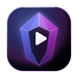
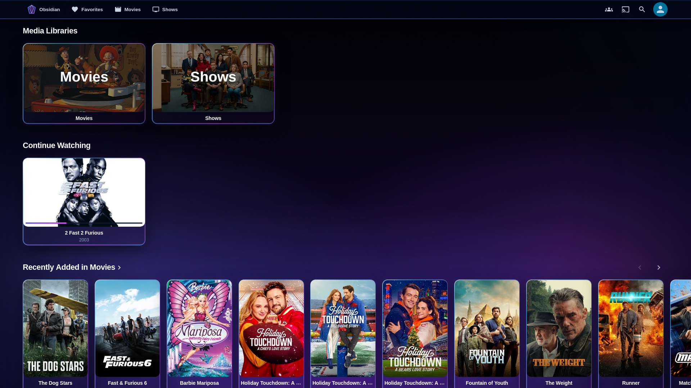
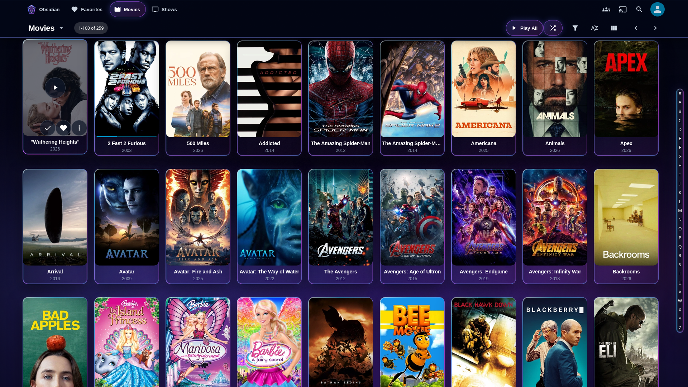
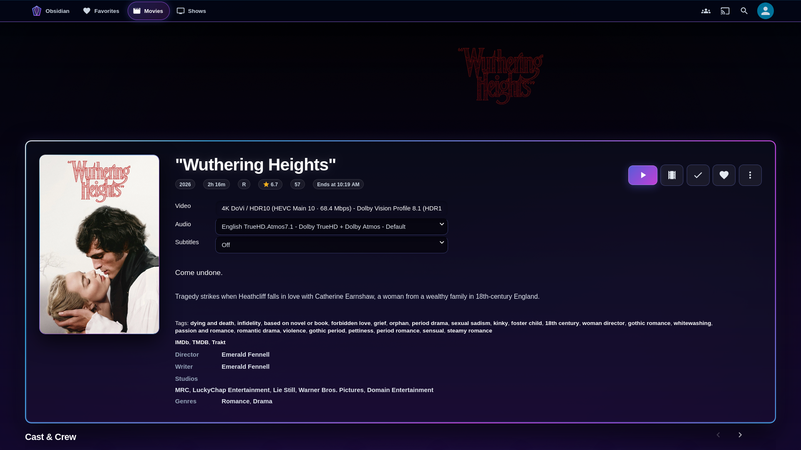
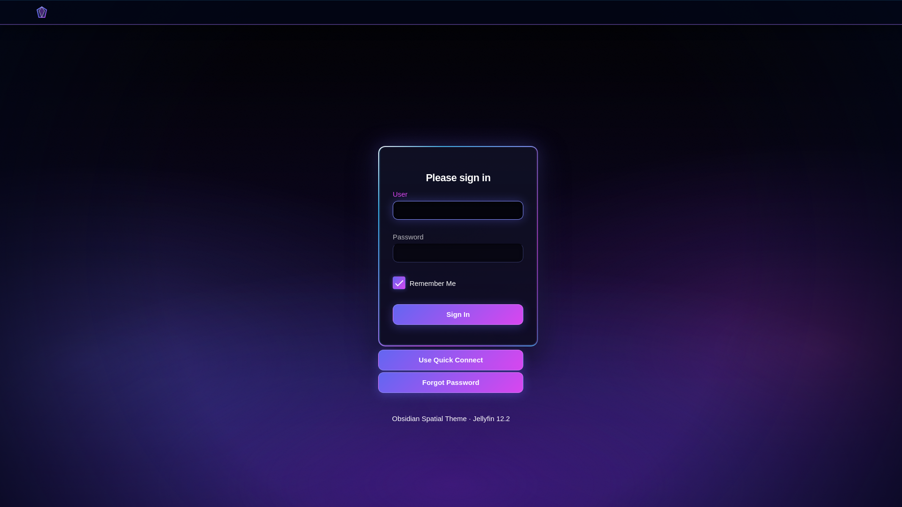
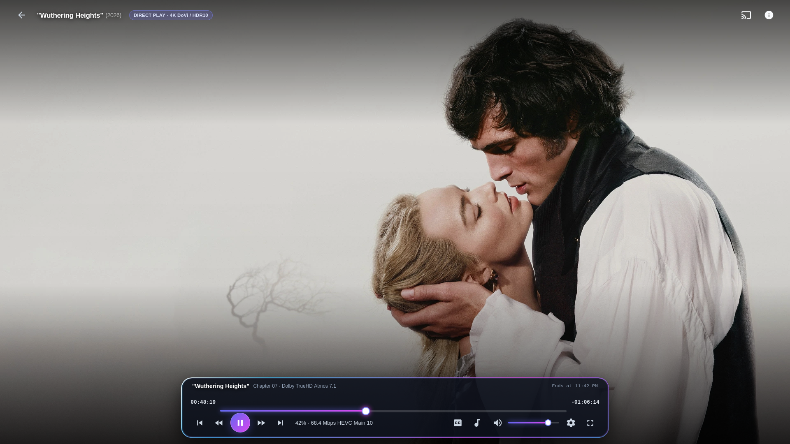
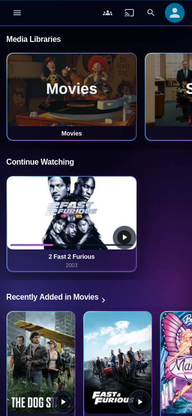
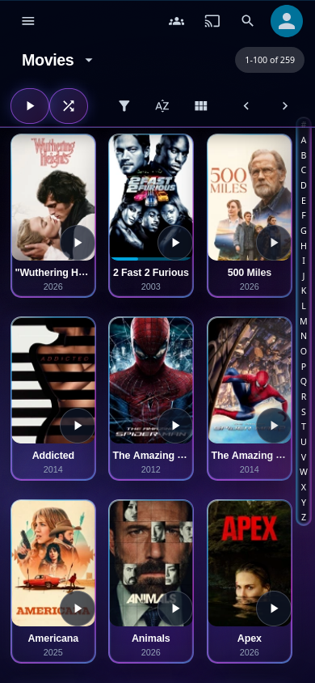
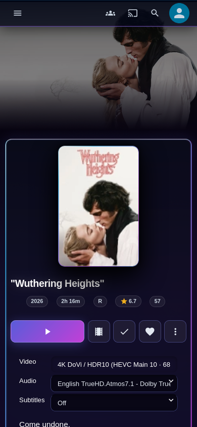

<div align="center">
  
  <h1>Obsidian 🔮</h1>
  <p><b>A Spatial 120Hz Glassmorphic Theme for Jellyfin Web 12.2+ &amp; Jellyfin Media Player</b></p>

  [](https://jellyfin.org/)
  [](./docs/architecture.md)
  [](./docs/presets.md)
  [](./docs/verification.md)
  [](./LICENSE)
</div>

---

## 🌌 The Vision

**Obsidian** is a high-contrast spatial theme for **Jellyfin Web 12.2+** and **Jellyfin Media Player (JMP)** grounded in the **Looplet Obsidian** design specification. Engineered to replace flat dark-gray containers with true `#000000` OLED depth, Obsidian pairs a hardware-cached 3-orb radial aurora with directional specular glass bevels (`0.28` top / `0.22` left) and a strict 120Hz GPU compositor budget.

Full dual-shell coverage ensures seamless visual continuity across Jellyfin 12.2's modern **`@mui/material`** React shell (`.MuiAppBar-root`, `.MuiDrawer-paper`, `.MuiDialog-paper`, `--mui-palette-*`) and updated **Hybrid/Legacy** views (`.cardBox`, `.itemDetailPage`, `ItemDetailsMetadataList`, `.videoOsdBottom`).

---

## 🖼️ Theme Gallery

### Desktop Views (`1920×1080`)

| | |
| :---: | :---: |
| <br>**Home Dashboard &amp; Media Libraries** | <br>**Movies Library Grid &amp; A–Z Glass Rail** |
| <br>**Cinematic Glass Hero &amp; Item Detail** | <br>**Spatial Aurora Authentication Screen** |

<div align="center">
  
  <p><b>Floating Dynamic Dock Video Player OSD</b></p>
</div>

### Mobile Responsive Views (`390×844` Touch Viewport)

| | | |
| :---: | :---: | :---: |
| <br>**Mobile Home &amp; Touch Scrollers** | <br>**Mobile 2-Column Poster Grid** | <br>**Mobile Glass Hero &amp; Metadata** |

---

## 🚀 Quick Installation

You can apply **Obsidian** server-wide (**Administration Dashboard > General > Branding > Custom CSS**) or to a single client (**User Avatar > Settings > Display > Custom CSS**).

### Method 1: 1-Line CDN `@import` (Recommended)

Paste the following single line into your **Custom CSS** box and click **Save**:

```css
@import url("https://cdn.jsdelivr.net/gh/McEveritts/Obsidian@main/obsidian.css");
```

To pin your installation to the `v2.0.0` release tag:

```css
@import url("https://cdn.jsdelivr.net/gh/McEveritts/Obsidian@v2.0.0/obsidian.css");
```

### Method 2: 100% Offline Standalone Installation (Zero External Calls)

**Obsidian** is engineered with an offline system font stack (`Inter`, Apple System, Segoe UI, Roboto) and inline SVG fractal grain textures—requiring zero external HTTP requests when pasted directly:

1. Open [`obsidian.css`](./obsidian.css) and copy its entire contents.
2. Navigate to **Dashboard > General > Branding > Custom CSS** (or **Settings > Display > Custom CSS**).
3. Paste the stylesheet, click **Save**, and perform a hard refresh (**Ctrl + F5** or **Cmd + Shift + R**).

---

## ✨ Key Architectural Pillars

### 🔮 1. Pure `#000000` Obsidian Base & 120Hz Atmospheric Engine
- **True OLED Contrast:** Anchored on `--obs-bg-base: #000000` and `--obs-slate-950: #000000` so letterboxed 2.39:1 cinema frames and floating glass surfaces blend naturally into the display bezel.
- **Hardware-Cached 3-Orb Radial Aurora (`body::before`):** Projects diffused `#6366f1` (Indigo), `#d946ef` (Fuchsia), and `#4f46e5` (Deep Indigo) light sources at `--obs-aurora-opacity: 0.55`. Locked into a static GPU layer by default (`--obs-aurora-animation: none`) for zero-repaint 120Hz scrolling.
- **Unified Spatial Vignette & SVG Micro-Grain (`body::after`):** Combines a peripheral vignette with an inline SVG `feTurbulence` noise layer (`opacity: 0.028`) to eliminate gradient banding without external asset fetches.

### 🏛️ 2. Full Jellyfin 12.2 Dual-Shell Coverage
- **Modern `@mui/material` Shell:** Bridges `:root` `--mui-palette-*` CSS variables and styles `.MuiAppBar-root`, `.MuiDrawer-paper`, `.MuiDialog-paper`, `.MuiPopover-paper`, `.MuiMenu-paper`, `.MuiButton-root`, `.MuiListItemButton-root`, and `.videoOsd-appBar`.
- **Updated 12.2 Item Detail DOM:** Directly styles `.detailPagePrimaryContainer` (`backdrop-filter: blur(24px)`) and the React `ItemDetailsMetadataList` (`.detailsGroupItem`) introduced when Jellyfin 12.2 removed the legacy `.detailPageContent` wrapper.

### 🃏 3. 120Hz Zero-Blur Media Cards & Specular Bevels
- **Compositor-Safe Card Grids:** Media libraries routinely render 100+ `.cardBox` elements simultaneously. Obsidian enforces `backdrop-filter: none !important` on individual cards, achieving glass depth via translucent obsidian fills (`rgba(12, 16, 28, 0.78)`), inset highlights, and directional `0.28` top / `0.22` left specular bevels.
- **Pointer-Gated Kinetic Lift:** On fine-pointer devices (`@media (hover: hover) and (pointer: fine)`), cards elevate smoothly (`translateY(-4px)`) with `scale3d(1.028, 1.028, 1)` poster zoom and an Indigo rim glow (`rgba(129, 140, 248, 0.55)`).

### 🎬 4. Floating Dynamic Dock OSD & WCAG 2.2 AAA Hit Targets
- **Suspended Playback Dock:** Detaches `.videoOsdBottom .osdControls` into a floating `20px`-radius frosted glass dock (`blur(24px)`) with an Indigo-to-Fuchsia glowing timeline scrub bar and pill-shaped primary Play/Pause toggle.
- **Short-Landscape & Compact Viewport Containment:** Automatically compresses OSD vertical padding on landscape phones (`max-height: 500px`), enforces `>= 44×44px` WCAG 2.2 AAA touch targets on interactive controls, and guarantees zero horizontal overflow down to `320×480` (`docScrollW === docClientW`).

---

## ⚡ Atmospheric & Performance Presets

Append any of the following snippets to the **very end** of your **Custom CSS** field (after the `@import` or pasted stylesheet) to customize the theme:

### 1. Animated Aurora Preset (25s Cosmic Oscillation)
*Enables continuous 3D hardware-accelerated oscillation on the radial aurora orbs.*

```css
/* --- OBSIDIAN PRESET: ANIMATED AURORA --- */
:root {
  --obs-aurora-opacity: 0.65 !important;
  --obs-aurora-animation: obs-aurora-shift 25s ease-in-out infinite alternate !important;
}
```

### 2. Balanced Preset (Laptops on Battery & Mobile Browsers)
*Reduces blur intensity, lowers aurora opacity, and disables micro-grain rasterization.*

```css
/* --- OBSIDIAN PRESET: BALANCED --- */
:root {
  --obs-glass-blur: 10px !important;
  --obs-glass-blur-heavy: 16px !important;
  --obs-aurora-opacity: 0.25 !important;
  --obs-aurora-animation: none !important;
  --obs-grain-display: none !important;
  --obs-card-lift: -2px !important;
}
```

### 3. Lite Preset (Smart TVs, Streaming Sticks & Low-Power Hardware)
*Removes all `backdrop-filter` calculations, disables background pseudo-elements, and applies high-contrast solid obsidian surfaces for maximum FPS.*

```css
/* --- OBSIDIAN PRESET: LITE (MAXIMUM FPS) --- */
:root {
  --obs-glass-blur: 0px !important;
  --obs-glass-blur-heavy: 0px !important;
  --obs-aurora-opacity: 0 !important;
  --obs-aurora-animation: none !important;
  --obs-grain-display: none !important;
  --obs-card-lift: 0px !important;
  --obs-card-bg: rgba(12, 16, 28, 0.94) !important;
  --obs-panel-bg: rgba(2, 6, 23, 0.96) !important;
  --obs-hero-bg: rgba(12, 16, 28, 0.96) !important;
}

body::before,
body::after {
  display: none !important;
}

.cardBox,
.MuiCard-root,
.dialog,
.formDialog,
.MuiDialog-paper,
.actionSheetContent,
.skinHeader,
.MuiAppBar-root,
.mainDrawer,
.MuiDrawer-paper,
.detailPagePrimaryContainer,
.videoOsdBottom .osdControls,
.nowPlayingBar,
.sliderBubble {
  backdrop-filter: none !important;
  -webkit-backdrop-filter: none !important;
}
```

---

## 📚 Documentation Portal

- **[Architecture & Spatial Design System](./docs/architecture.md)** — Deep dive into `--obs-*` tokens, the 120Hz atmospheric engine, directional specular bevels, and Jellyfin 12.2 dual-shell coverage.
- **[Atmospheric & Chromatic Presets](./docs/presets.md)** — Complete collection of performance presets and custom accent color palettes (Emerald Cyber-Glass, Crimson Eclipse).
- **[Verification & Responsive Audit](./docs/verification.md)** — Build gates, selector contract verification against upstream `jellyfin-web 12.2`, and live Playwright Firefox telemetry across desktop and mobile viewports.

---

## 🛠️ Building from Source

Obsidian is authored as 10 modular CSS files in [`src/`](./src) and compiled into a single validated stylesheet via [`build.js`](./build.js).

```text
Obsidian/
├── obsidian.css                  # Compiled standalone master stylesheet
├── preview.html                  # Interactive standalone browser test harness
├── build.js                      # Deterministic compiler, syntax & zero-external-dep gate
├── package.json                  # Build & verification scripts
├── assets/logo/obsidian-logo.svg # Spatial Obsidian crystal emblem
├── docs/                         # Architecture, preset guides, & screenshot gallery
├── scripts/
│   ├── checkSyntax.js            # JS syntax validation runner
│   └── precise_audit.js          # Upstream jellyfin-web 12.2 selector contract auditor
└── src/
    ├── 01-variables.css          # --obs-* tokens & --mui-palette-* bridge
    ├── 02-atmosphere.css         # 120Hz radial aurora orbs, vignette & inline SVG grain
    ├── 03-typography.css         # Inter system font stack, fluid scaling & scrollbars
    ├── 04-header-nav.css         # Modern MUI AppBar/Drawer + Legacy Header/Drawer
    ├── 05-cards.css              # 16px poster cards, specular bevels & hover lift
    ├── 06-item-detail.css        # Jellyfin 12.2 glass hero & ItemDetailsMetadataList
    ├── 07-player-osd.css         # Floating Dynamic Dock OSD & glowing scrub slider
    ├── 08-dialogs-inputs.css     # Frosted modals, action sheets & dark-glass inputs
    ├── 09-login.css              # Centered glass hero login screen
    └── 10-presets.css            # Reduced-motion, forced-colors & GPU compositor rules
```

```bash
# Run syntax checks and rebuild obsidian.css
npm test

# Or run the compiler directly
npm run build
```

---

## 📄 License

This project is open-source software licensed under the [MIT License](./LICENSE).
