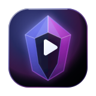
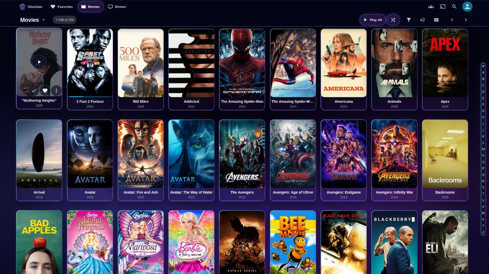
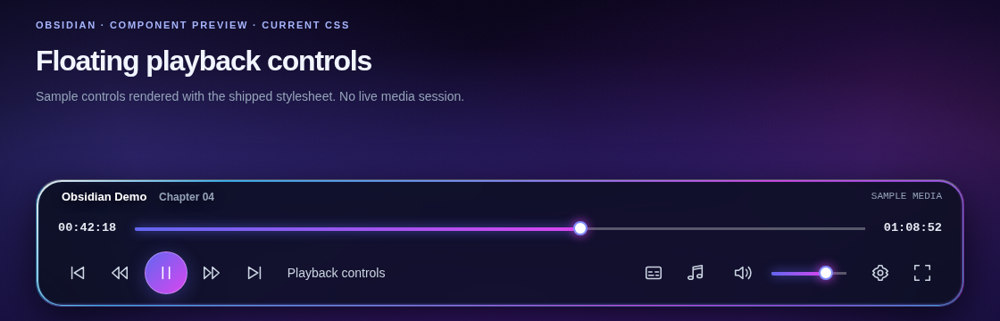
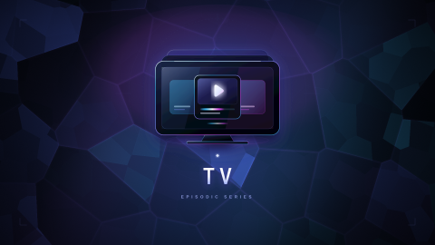
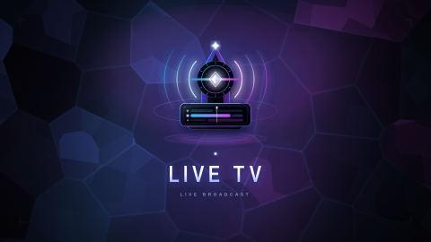
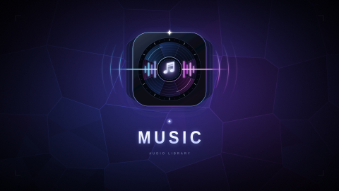
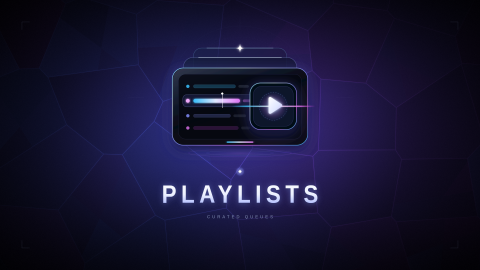

<div align="center">
  
  <h1>Obsidian</h1>
  <p><b>Dark glass. Soft aurora. Your Jellyfin.</b></p>
  <p>A custom CSS theme for Jellyfin Web, with matching library artwork.</p>

  [](https://github.com/McEveritts/Obsidian/actions/workflows/ci.yml)
  [](./LICENSE)

  **[Install](#install) · [Playback controls](#playback-controls) · [Download covers](#library-covers) · [Gallery](./docs/gallery.md) · [Presets](./docs/presets.md)**
</div>

[](./docs/screenshots/03-desktop-library-grid.png)

*Your own posters and media appear after installation. Click the image to view the full-size library screenshot.*

## Playback controls

A floating glass dock brings together the timeline, chapter controls, play/pause, audio, subtitles, volume, and player settings.

[](./docs/screenshots/playback-controls-preview.png)

**Current-CSS component preview:** rendered from the shipped stylesheet with sample markup, not a live playback screenshot. Available controls depend on your Jellyfin client and media.

<details>
<summary><b>See volume and Up Next overlays</b></summary>

[](./docs/screenshots/playback-overlays-preview.png)

Sample episode information is used to show the current glass surfaces and buttons. [Preview source and capture notes](./docs/screenshots/README.md).

</details>

## Library covers

**Six included PNGs, each 1920 × 1080.** Click a cover to open the full-resolution artwork and download it.

| Movies | Shows | Live TV |
| :---: | :---: | :---: |
| [](./assets/covers/movies.png) | [](./assets/covers/tv.png) | [](./assets/covers/live-tv.png) |

| Collections | Music | Playlists |
| :---: | :---: | :---: |
| [](./assets/covers/collections.png) | [](./assets/covers/music.png) | [](./assets/covers/playlists.png) |

[Browse the cover pack](./assets/covers/README.md) · [How to upload covers in Jellyfin](./docs/getting-started.md#add-the-matching-covers)

Covers are optional artwork uploads. Installing the CSS does not replace your library images automatically.

## Install

Save a copy of your existing Custom CSS, then paste this **before other CSS rules** in **Dashboard → Branding → Custom CSS** (Branding may be under General):

```css
@import url("https://cdn.jsdelivr.net/gh/McEveritts/Obsidian@main/obsidian.css");
```

Save and refresh Jellyfin. If needed, hard refresh with **Ctrl + F5** or **Cmd + Shift + R**. No build tools or JavaScript are needed for the theme.

**Prefer a local copy?** Open [`obsidian.css`](./obsidian.css), choose **Raw**, and paste the entire file instead. The stylesheet uses system fonts and inline textures, with no required external font or image requests.

The `@main` import follows development updates, subject to CDN/browser caching. Pin a full commit SHA to keep a fixed snapshot. The `v2.0.0` tag predates later fixes on `main`.

[Full setup, client settings, updates, and removal](./docs/getting-started.md#install-the-theme)

## Screenshots

[**Open the full gallery →**](./docs/gallery.md)

The gallery includes the retained movie library view, fresh desktop/mobile sign-in captures, and clearly labeled playback component previews. Sign-in screenshots show the example server's own background branding, which is separate from the theme.

## Make it yours

| Option | What it changes |
| :--- | :--- |
| **Default** | Static aurora, dark glass surfaces, indigo/fuchsia accents. |
| **Balanced / Lite** | Reduce blur and background effects for lower-power devices. |
| **Animated aurora** | Opt into a slowly moving background. |
| **Accent colors** | Switch to an alternate palette or adjust the theme tokens. |
| **Controller companion** | Optional script for specific keyboard/TV menu-focus and Back/B behavior. |

[Performance and color presets](./docs/presets.md) · [Controller companion setup](./docs/getting-started.md#optional-controller-and-keyboard-companion)

Obsidian also styles item details, dialogs, Live TV, music/lyrics, and reader views where Jellyfin provides them. It changes presentation; Jellyfin still handles your library and playback.

## Compatibility

Targets Jellyfin Web 12.2+ and clients that load its Custom CSS, including Jellyfin Media Player's embedded web UI. Independent native interfaces do not automatically inherit the theme. The project includes 12.4 component regression fixtures and legacy selectors; coverage varies by client/version.

Actual performance depends on the browser and device. [Verification notes](./docs/verification.md) document test coverage and limitations.

## Documentation

[Getting started](./docs/getting-started.md) · [Gallery](./docs/gallery.md) · [Presets](./docs/presets.md) · [Architecture](./docs/architecture.md) · [Verification](./docs/verification.md) · [Report an issue](https://github.com/McEveritts/Obsidian/issues)

<details>
<summary><b>Development and preview tooling</b></summary>

Edit the twelve modules in [`src/`](./src), then rebuild the committed stylesheet:

```bash
npm test
```

For browser suites, install development dependencies with `npm ci` and Chromium with `npx playwright install chromium`, then run the suites listed in [Verification](./docs/verification.md).

Regenerate the component previews and lightweight artwork thumbnails with:

```bash
node scripts/renderShowcase.js
```

`OBSIDIAN_CHROMIUM_PATH` can select an existing Chromium executable. The renderer uses the current `obsidian.css` and original cover files; it does not require server access or credentials. See [capture notes](./docs/screenshots/README.md).

To try the older standalone design demonstrator, download the repository and open [`preview.html`](./preview.html) beside `obsidian.css`. Its view/preset toolbar uses sample markup and placeholder art; it has no working media playback or server connection.

</details>

[MIT License](./LICENSE). Jellyfin and the example media artwork belong to their respective owners.
