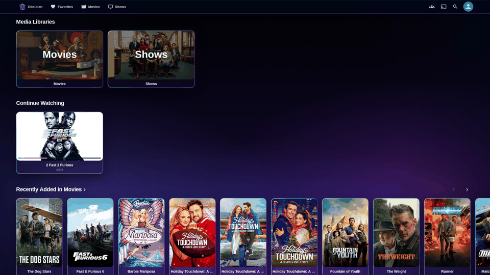
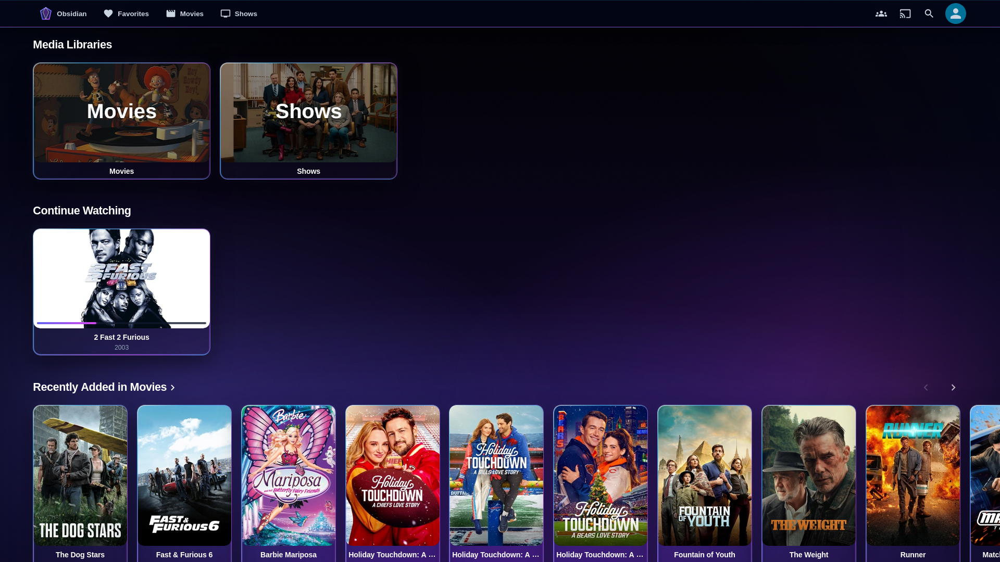
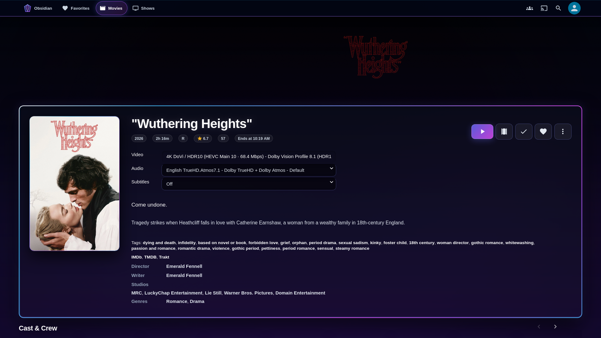
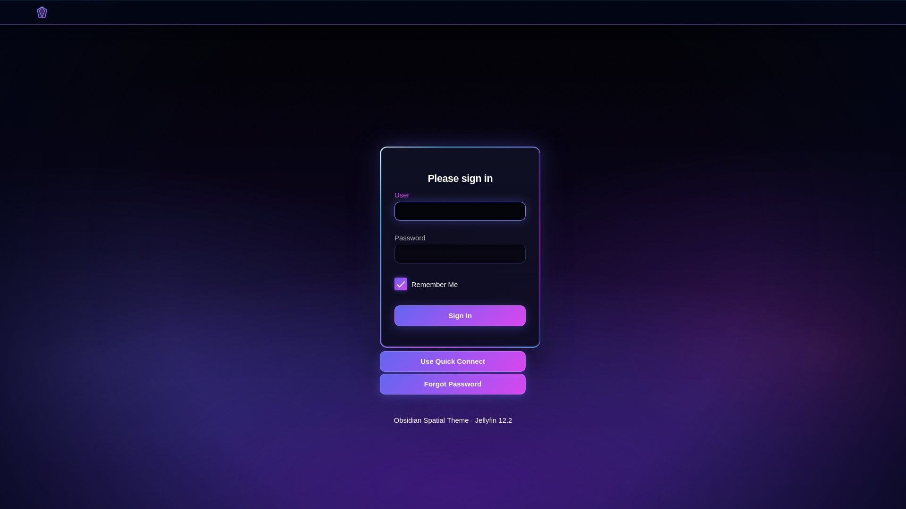
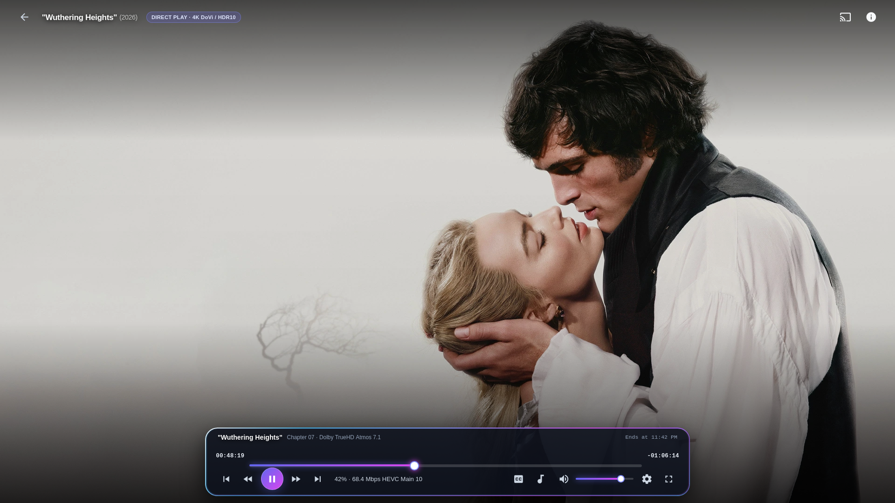
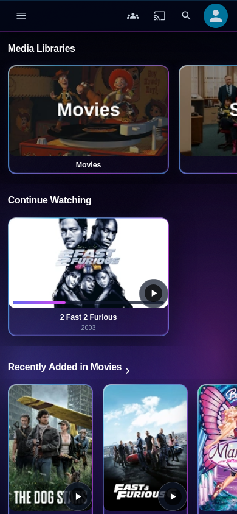
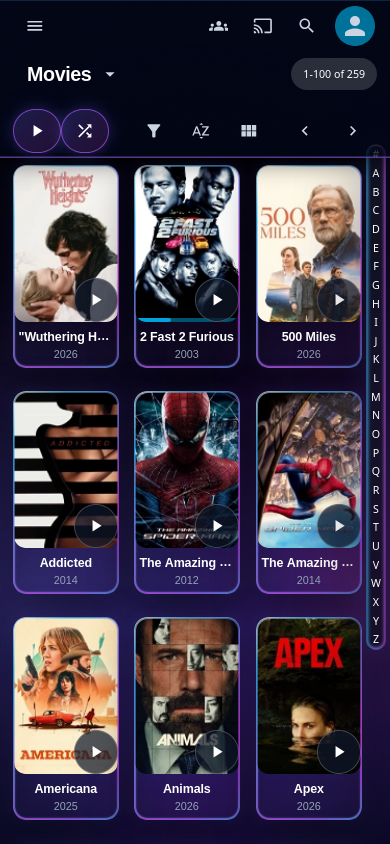
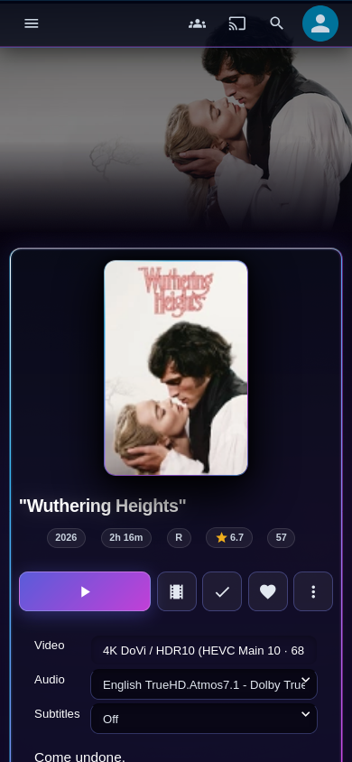
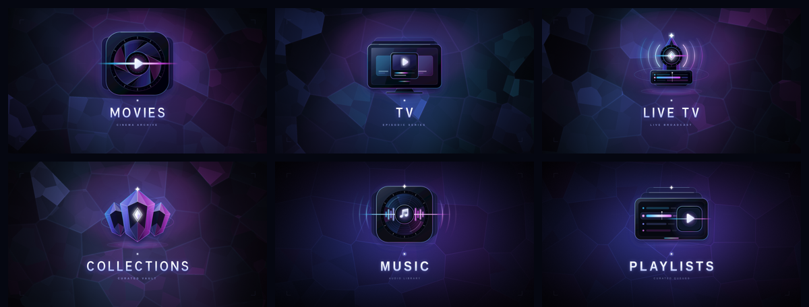

<div align="center">
  
  <h1>Obsidian for Jellyfin</h1>
  <p><b>Deep blacks. Frosted glass. Indigo and fuchsia light.</b></p>
  <p>A custom CSS theme for Jellyfin Web and clients that use its web interface.</p>

  [](https://github.com/McEveritts/Obsidian/actions/workflows/ci.yml)
  [](./LICENSE)

  **[Install](#install) · [Screenshots](#screenshots) · [How it works](#how-it-works) · [Getting started](./docs/getting-started.md) · [Presets](./docs/presets.md)**
</div>



*A looping slideshow of the included Jellyfin Web screenshots, not a playback recording. [Browse the full-size stills below](#screenshots). Artwork and libraries belong to the example installation; your own media appears after installing the theme.*

## What you get

- **A dark glass interface:** a black base, soft aurora background, highlighted card edges, and frosted navigation and dialogs.
- **A consistent library and player:** styled posters, details, search, playback controls, volume, Up Next, and subtitle panels.
- **More than movies:** styling for Live TV guides and channels, music and lyrics, photos, and book/comic readers where Jellyfin provides those views.
- **Responsive layouts:** compact phone layouts, touch scrollers, desktop hover effects, and visible TV/keyboard focus.
- **Your choice of atmosphere:** static lighting by default, plus animated, Balanced, Lite, and accent-color [presets](./docs/presets.md).
- **Optional extras:** six matching library covers and a controller/keyboard navigation script.

The theme is CSS-only by default. You do **not** need Node.js, a build step, or the companion script to install it.

## Install

1. Open your Jellyfin **Dashboard → Branding → Custom CSS**. Some versions place Branding under **General**. This requires an administrator and applies to web clients that load the server's custom CSS.
2. Paste the following line **before any other CSS rules**, then save:

   ```css
   @import url("https://cdn.jsdelivr.net/gh/McEveritts/Obsidian@main/obsidian.css");
   ```

3. Reload Jellyfin. If the old styling remains, hard refresh with **Ctrl + F5** or **Cmd + Shift + R**.

The `@main` URL follows development updates, subject to CDN/browser caching. For a fixed version, replace `main` with a full Git commit SHA from the [commit history](https://github.com/McEveritts/Obsidian/commits/main/). The existing `v2.0.0` tag is an earlier snapshot and does not include every change on `main`.

**Offline or CDN blocked?** Open [`obsidian.css`](./obsidian.css), select **Raw**, and paste the entire stylesheet into Custom CSS instead of the import. The stylesheet uses system fonts and inline textures, with no required external font or image requests. Jellyfin itself still needs access to your server and media.

**Client-only install, upgrades, and removal:** see the [step-by-step guide](./docs/getting-started.md#install-the-theme). Save your existing custom CSS before replacing it.

## Screenshots

These are the repository's existing Jellyfin Web 12.2 gallery captures. They show the theme in a real web interface; newer styling on `main` can differ. Mobile images use emulated viewports. The [verification notes](./docs/verification.md) distinguish live checks from browser fixtures and physical hardware testing.

### Desktop

Click an image for its full-size version.

| Home and libraries | Movie library |
| :---: | :---: |
| [](./docs/screenshots/02-desktop-home.png) | [](./docs/screenshots/03-desktop-library-grid.png) |

| Item details | Sign in |
| :---: | :---: |
| [](./docs/screenshots/04-desktop-item-detail.png) | [](./docs/screenshots/01-desktop-login.png) |

[](./docs/screenshots/05-desktop-player-osd.png)

*The playback dock keeps Jellyfin's controls together above the bottom edge of the video.*

### Mobile

| Home | Library | Item details |
| :---: | :---: | :---: |
| [](./docs/screenshots/06-mobile-home.png) | [](./docs/screenshots/07-mobile-library-grid.png) | [](./docs/screenshots/08-mobile-item-detail.png) |

## How it works

Jellyfin loads [`obsidian.css`](./obsidian.css) through its Custom CSS setting. The stylesheet changes the appearance of existing Jellyfin components: navigation, cards, dialogs, detail pages, and player overlays. Your server still handles your library, accounts, playback, and media metadata.

| In Jellyfin | With Obsidian |
| :--- | :--- |
| Browse Home or open a library | Glass-edged cards and indigo/fuchsia highlights surround your own artwork. |
| Open a movie, episode, or album | Details and actions sit on a dark glass surface. Use Jellyfin's normal playback and track choices. |
| Play a video | Jellyfin's timeline and transport controls appear in a floating dock. Available controls still depend on your client and media. |
| Use a phone or tablet | Responsive cards and touch-scrolling rows adapt to the viewport. |
| Use a keyboard or TV remote | The CSS provides visible focus styles. The optional script below improves specific popover navigation behavior. |

For a guided first run, follow [Browse → Details → Playback](./docs/getting-started.md#take-a-first-run-tour).

### Try the design without a Jellyfin server

Download the repository from **Code → Download ZIP**, extract it, and open [`preview.html`](./preview.html) in a browser, keeping it beside `obsidian.css`. Use its toolbar to switch between **Home Grid**, **Item Detail**, **Video OSD**, **Login Hero**, and **Dialog**, or compare **Full**, **Balanced**, and **Lite** token settings.

This is a small standalone design demonstrator with placeholder artwork and sample markup. It has no server connection or working media playback, and is not a complete Jellyfin client. Use the [preset snippets](./docs/presets.md) for the full configuration in Jellyfin. GitHub's file view displays the HTML source; download it to try it.

### Optional Xbox, TV, and keyboard navigation

[`scripts/obsidian-xbox-nav.js`](./scripts/obsidian-xbox-nav.js) improves focus entry into menus, selectable view-menu items, Back/B dismissal of MUI overlays, and desktop Up/Down movement in filter/view popovers. It supplements Jellyfin's input handling; it is not a general gamepad driver.

It requires access to Jellyfin Web's files and a script tag in `index.html`; pasting it into Custom CSS will not load it. See [installation, controls, and removal](./docs/getting-started.md#optional-controller-and-keyboard-companion).

## Matching library covers



Each cover is a **1920 × 1080 PNG**. Download the ones you want and upload them through Jellyfin's image editor; CSS does not install them automatically.

**[Movies](./assets/covers/movies.png) · [Shows](./assets/covers/tv.png) · [Live TV](./assets/covers/live-tv.png) · [Collections](./assets/covers/collections.png) · [Music](./assets/covers/music.png) · [Playlists](./assets/covers/playlists.png)**

[How to apply library artwork](./docs/getting-started.md#add-the-matching-covers)

## Compatibility and performance

The project targets **Jellyfin Web 12.2+**, including the 12.4 component markup covered by its regression fixtures. It also contains legacy 10.11 selectors and targets Jellyfin Media Player's embedded web UI. Coverage varies with the installed web client; native clients that do not load Jellyfin Web's Custom CSS will not inherit this theme.

The default aurora is static, and poster cards avoid individual backdrop blurs to reduce rendering work. Actual frame rate depends on your browser, device, and library. **120Hz is a design target, not a measured guarantee.** Reduced-motion and forced-color preferences have dedicated rules; the project does not claim blanket WCAG certification or physical-device coverage.

Start with the [Balanced or Lite preset](./docs/presets.md) if your client struggles with glass effects. For exact checks and limitations, read [Verification](./docs/verification.md).

## Documentation and development

- [Getting started](./docs/getting-started.md) — installation, first-run tour, covers, controller setup, updates, removal, and troubleshooting.
- [Presets](./docs/presets.md) — performance settings, animated aurora, and accent colors. Append snippets after the import or pasted stylesheet.
- [Architecture](./docs/architecture.md) — design tokens and the twelve CSS modules in `src/`.
- [Verification](./docs/verification.md) — build checks, responsive fixtures, and recorded live-browser results.
- [Report an issue](https://github.com/McEveritts/Obsidian/issues) — include your web-client version, browser/client, viewport, and a screenshot without account details.

Edit the source modules in [`src/`](./src), then rebuild the committed `obsidian.css`:

```bash
npm test
```

For browser regression suites:

```bash
npm ci
npx playwright install chromium
npm run test:live-tv
npm run test:player-osd
npm run test:global-controls
npm run test:shell-overlays
npm run test:music-readers
npm run test:cards-tables
npm run test:xbox-nav
```

`npm run audit:selectors` checks selectors against an upstream tree when available; set `OBSIDIAN_UPSTREAM_DIR` to its `src` directory. See [Verification](./docs/verification.md) for browser-path overrides and audit limitations. CI runs the build and browser suites on pushes and pull requests.

To regenerate the gallery slideshow and cover contact sheet, install [Pillow](https://pillow.readthedocs.io/) in your development environment and run `python3 scripts/buildShowcase.py`. This is optional documentation tooling and is not needed to use or build the theme.

## License

[MIT](./LICENSE). Jellyfin and the media artwork shown in screenshots belong to their respective owners.
