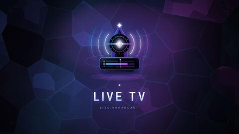

# Obsidian library artwork

Six matching covers, ready to upload as **Primary** library artwork. Every original is a **1920 × 1080 PNG**. Click an image or its name, then use GitHub's download button to save the full-resolution file.

| [Movies](./movies.png) | [Shows](./tv.png) | [Live TV](./live-tv.png) |
| :---: | :---: | :---: |
|  |  |  |

| [Collections](./collections.png) | [Music](./music.png) | [Playlists](./playlists.png) |
| :---: | :---: | :---: |
|  |  |  |

## Apply a cover

1. Download the PNG for the library you want to customize.
2. In Jellyfin, open that library's **… → Edit images** menu as an administrator. This may also be available through **Dashboard → Libraries**.
3. Upload the PNG as the **Primary** image, save, and reload Home.

Some built-in shortcuts do not expose an image editor in every Jellyfin version. Uploads are optional and separate from the CSS installation; they do not replace individual movie or episode posters.

[Detailed artwork instructions](../../docs/getting-started.md#add-the-matching-covers) · [Theme overview](../../README.md)
