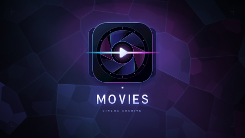
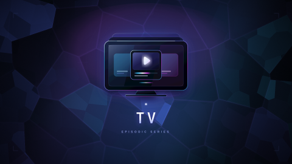
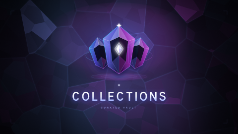
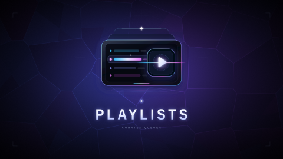

# Library covers

Six optional 1920 × 1080 PNG covers matching Obsidian's dark glass look. Click any cover to open the full-resolution file and download it.

| [Movies](./movies.png) | [Shows](./tv.png) | [Live TV](./live-tv.png) |
| :---: | :---: | :---: |
|  |  |  |

| [Collections](./collections.png) | [Music](./music.png) | [Playlists](./playlists.png) |
| :---: | :---: | :---: |
|  |  |  |

## How to apply

1. Download the PNG you want.
2. In Jellyfin, open the library's **… → Edit images** menu (or via **Dashboard → Libraries**).
3. Upload it as the **Primary** image, save, and refresh Home.

[Setup guide](../../docs/getting-started.md#add-the-matching-covers) · [Overview](../../README.md)
