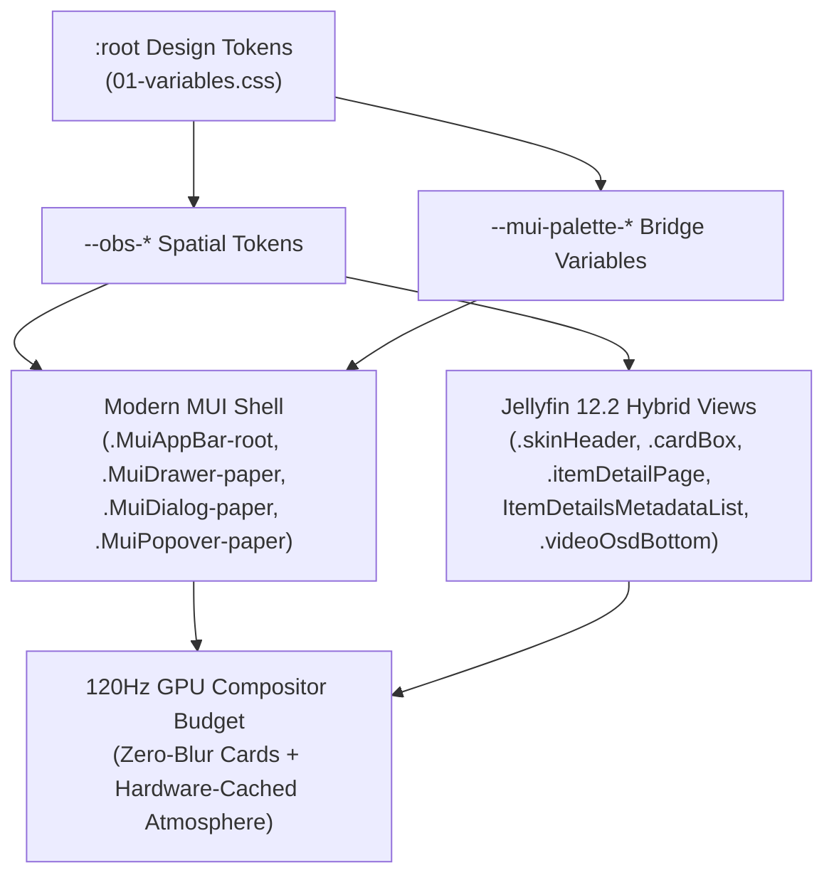

# 🏛️ Obsidian Architecture & Spatial Design System

**Obsidian v2.0** is a modular, zero-dependency spatial stylesheet engineered for **Jellyfin Web 12.2+** and **Jellyfin Media Player (JMP)**. Grounded in the **Looplet Obsidian** design specification, it bridges Jellyfin 12.2's dual-shell architecture—styling both the modern `@mui/material` React views and legacy/hybrid Emby DOM surfaces under a single unified visual language.

---

## 1. Visual Foundations

### Pure `#000000` Obsidian Canvas & 120Hz Atmospheric Engine
Unlike conventional dark themes that wash the viewport in flat mid-tone grays, Obsidian anchors its depth hierarchy on true OLED `#000000` (`--obs-bg-base: #000000`, `--obs-slate-950: #000000`) layered with two hardware-cached atmospheric pseudo-elements:

- **`body::before` — Static 120Hz 3-Orb Radial Aurora:** Renders three diffused chromatic light sources (`#6366f1` Indigo at top-left, `#d946ef` Fuchsia at center-right, and `#4f46e5` Deep Indigo at bottom-center) at `--obs-aurora-opacity: 0.55`. By default, `--obs-aurora-animation: none` locks the aurora into a static GPU texture (`transform: translate3d(0, 0, 0)`), eliminating per-frame compositor repaints during 120Hz scrolling.
- **`body::after` — Unified Spatial Vignette & Fractal Micro-Grain:** Combines an edge-darkening radial vignette with an inline SVG `feTurbulence` fractal noise overlay (`opacity: 0.028`) to prevent color banding on 8-bit and 10-bit displays without external image requests.

### Directional Specular Bevels
Every floating glass container (`.cardBox`, `.detailPagePrimaryContainer`, `.videoOsdBottom .osdControls`, `.MuiDialog-paper`, `.dialog`) simulates physical overhead-left illumination using directional border tokens:

| Token | Value | Role |
| :--- | :--- | :--- |
| `--obs-glass-border` | `rgba(129, 140, 248, 0.34)` | Base chromatic Indigo perimeter glass border |
| `--obs-specular-top` | `rgba(255, 255, 255, 0.28)` | Top edge overhead specular highlight |
| `--obs-specular-left` | `rgba(56, 189, 248, 0.38)` | Left edge Cyan chromatic specular highlight |
| `--obs-glass-border-hover` | `rgba(168, 85, 247, 0.68)` | Active / pointer-hover Purple-Fuchsia rim glow |
| `--obs-glass-blur` | `16px` | Standard navigation & surface backdrop blur |
| `--obs-glass-blur-heavy` | `24px` | Hero containers, OSD dock, & modal dialogs |

---

## 2. Dual-Shell Jellyfin 12.2 Coverage

Jellyfin 12.2 introduced a hybrid architecture where top-level navigation, drawers, dialogs, and admin dashboards render via **Material UI (`@mui/material`)** while media carousels, library grids, item detail pages, and the video player OSD use updated custom DOM components.

### Key 12.2 Structural Adaptations
1. **Material UI CSS Variable Bridge:** Overrides `--mui-palette-background-default`, `--mui-palette-background-paper`, `--mui-palette-primary-main`, and `--mui-palette-AppBar-darkBg` directly at `:root` so React components inherit Obsidian's palette before runtime emotion styles evaluate.
2. **Updated 12.2 Item Detail DOM (`06-item-detail.css`):** Jellyfin 12.2 removed the legacy `.detailPageContent` wrapper in `src/controllers/itemDetails/index.html` and migrated metadata rows to the React `ItemDetailsMetadataList` component (`.detailsGroupItem`, `.label`, `.content`). Obsidian targets `.detailPagePrimaryContainer` directly as the frosted glass hero card and aligns `.detailPageSecondaryContainer` seamlessly underneath.
3. **120Hz Card Compositor Budget (`05-cards.css`):** Media grids routinely mount 50–200 `.cardBox` elements simultaneously. Applying `backdrop-filter: blur()` to individual cards causes severe frame drops on 4K displays. Obsidian enforces `backdrop-filter: none !important` on `.cardBox`, achieving its glassmorphic depth via rich translucent fills (`--obs-card-bg: rgba(12, 16, 28, 0.78)`), inner inset highlights, and directional `0.28`/`0.22` specular borders.

---

## 3. Modular Source Pipeline

All styling is authored across 10 ordered modules in [`src/`](../src) and compiled into [`obsidian.css`](../obsidian.css) via [`build.js`](../build.js):

| Module | Responsibility |
| :--- | :--- |
| [`01-variables.css`](../src/01-variables.css) | `--obs-*` design tokens, `--mui-palette-*` bridge, and Jellyfin root theme variables |
| [`02-atmosphere.css`](../src/02-atmosphere.css) | Pure `#000000` canvas, `body::before` 3-orb radial aurora, `body::after` vignette + SVG micro-grain |
| [`03-typography.css`](../src/03-typography.css) | Offline `Inter` system font stack, fluid typographic scale, section title alignment, custom scrollbars |
| [`04-header-nav.css`](../src/04-header-nav.css) | `.MuiAppBar-root` & `.skinHeader` glass bars, `.MuiDrawer-paper` & `.mainDrawer` navigation, 44px hit targets |
| [`05-cards.css`](../src/05-cards.css) | 16px rounded media cards, pointer-gated hover lift (`translateY(-4px)`), artwork zoom, progress bars |
| [`06-item-detail.css`](../src/06-item-detail.css) | `.detailPagePrimaryContainer` glass hero, floating poster, metadata pills, primary Indigo-to-Fuchsia Play CTA |
| [`07-player-osd.css`](../src/07-player-osd.css) | Floating Dynamic Dock (`.videoOsdBottom .osdControls`), glowing scrub slider, short-landscape (`<= 500px`) compression |
| [`08-dialogs-inputs.css`](../src/08-dialogs-inputs.css) | `.MuiDialog-paper`, `.dialog`, `.actionSheetContent`, recessed dark-glass inputs & `<select>` menus |
| [`09-login.css`](../src/09-login.css) | Centered glass hero authentication card (`#loginPage`), glowing focus rings, touch-safe submit controls |
| [`10-presets.css`](../src/10-presets.css) | `prefers-reduced-motion: reduce`, `forced-colors: active` accessibility fallbacks, and preset hooks |
