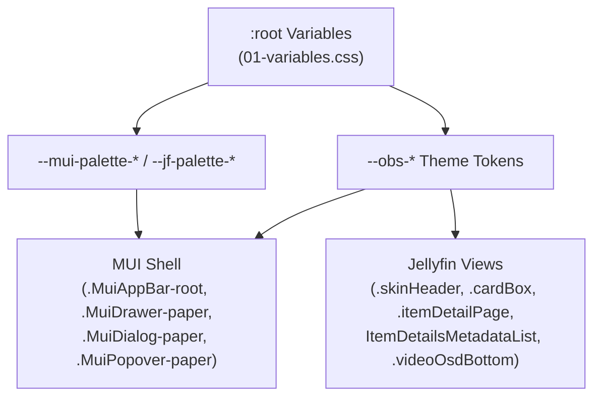

# Architecture

Obsidian is a modular Custom CSS theme built for **Jellyfin Web 12.2+** and **Jellyfin Media Player**. It styles both the Material UI (`@mui/material`) shell and Jellyfin's hybrid/legacy views from a shared set of CSS variables, with no external font or image dependencies.

## Visual approach

- **Pure `#000000` canvas (`02-atmosphere.css`):** Uses `#000000` as the base background, layered with a static radial gradient aurora on `body::before` (`--obs-aurora-animation: none` by default so scrolling doesn't trigger constant repaints) and a vignette plus inline SVG noise texture on `body::after` to avoid gradient banding.
- **Glass borders & blur (`01-variables.css`):** Floating panels (`.detailPagePrimaryContainer`, `.videoOsdBottom .osdControls`, `.MuiDialog-paper`, `.dialog`, `.skinHeader`, `.MuiAppBar-root`) use translucent backgrounds, backdrop blur (`16px` / `24px`), and subtle top/left highlight borders.
- **No blur on poster cards (`05-cards.css`):** Library grids can render 50–200 `.cardBox` nodes at once, where per-card `backdrop-filter` causes heavy frame drops. Cards explicitly set `backdrop-filter: none !important` and use translucent dark fills with border highlights instead.

## Jellyfin 12.2+ dual-shell coverage

Jellyfin 12.2+ splits the UI between Material UI React components (header, drawers, dialogs, dashboard) and custom/legacy DOM views (carousels, library grids, item details, video OSD).

- **MUI variable bridge (`01-variables.css`):** Overrides `--mui-palette-*` and `--jf-palette-*` on `:root` so MUI components inherit Obsidian's colors directly.
- **Item details (`06-item-detail.css`):** Targets `.detailPagePrimaryContainer` and the React metadata list (`.detailsGroupItem`, `.label`, `.content`) introduced after `.detailPageContent` was removed in 12.2.

## Source modules

The 12 ordered modules in [`src/`](../src) concatenate into [`obsidian.css`](../obsidian.css) via [`build.js`](../build.js):

| Module | Scope |
| :--- | :--- |
| [`01-variables.css`](../src/01-variables.css) | `--obs-*` tokens, `--mui-palette-*` / `--jf-palette-*` overrides, and root variables |
| [`02-atmosphere.css`](../src/02-atmosphere.css) | `#000000` base canvas, `body::before` aurora, `body::after` vignette + inline SVG grain |
| [`03-typography.css`](../src/03-typography.css) | System font stack, heading/body scale, section alignment, custom scrollbars |
| [`04-header-nav.css`](../src/04-header-nav.css) | `.MuiAppBar-root`, `.skinHeader`, drawers, toasts, multi-select toolbar, banners, SyncPlay, Cast Remote |
| [`05-cards.css`](../src/05-cards.css) | Rounded poster cards, media/sync/recording badges, `.personCard`, hover states |
| [`06-item-detail.css`](../src/06-item-detail.css) | `.detailPagePrimaryContainer` glass hero, metadata pills, Play CTA, `.detailTable`, search bar |
| [`07-player-osd.css`](../src/07-player-osd.css) | Floating playback dock, volume/brightness OSD, Up Next, skip button, stats, subtitle sync, chapters |
| [`08-dialogs-inputs.css`](../src/08-dialogs-inputs.css) | `.MuiDialog-paper`, `.dialog`, global buttons, spinners, switches, inputs |
| [`09-login.css`](../src/09-login.css) | Centered glass login card (`#loginPage`) and `.quickConnectError` |
| [`10-presets.css`](../src/10-presets.css) | `prefers-reduced-motion`, `forced-colors` fallbacks, and preset hooks |
| [`11-live-tv.css`](../src/11-live-tv.css) | Home shortcuts, aligned Guide headers, contained channel logos, equal-height channel cards |
| [`12-music-readers.css`](../src/12-music-readers.css) | Synced `.lyricPage`, `.nowPlayingBar` & queue, `.slideshowDialog`, `#bookPlayer` / `#dialogToc`, `#comicsPlayer`, `.logoScreenSaver` |
