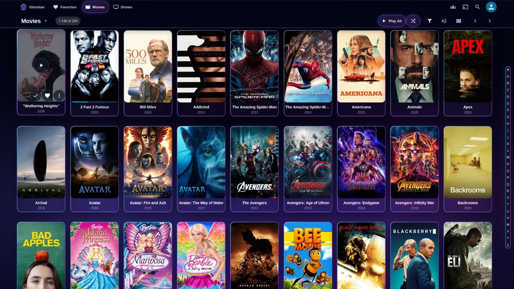
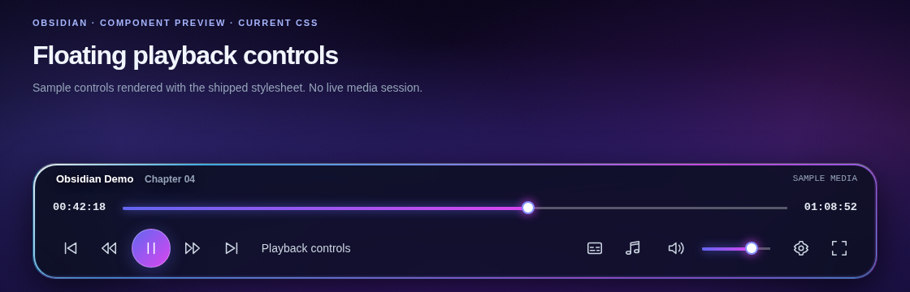
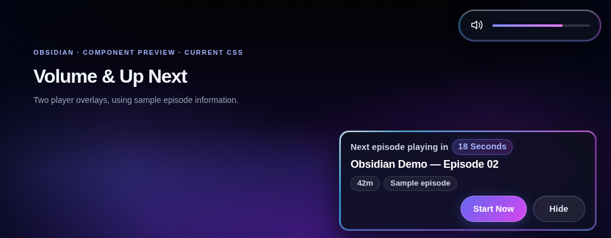
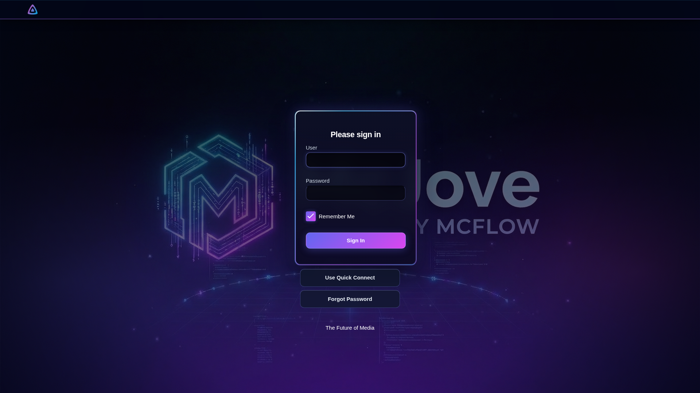
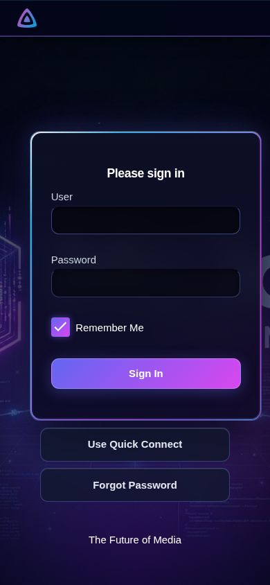

# Gallery

[Overview](../README.md) · [Install](./getting-started.md) · [Library covers](../assets/covers/README.md)

## Movie library

Click for the 1920 × 1080 screenshot.

## Playback controls

Component preview rendered from `obsidian.css` with sample controls (not a live playback screenshot).

## Volume and Up Next

Component previews rendered from `obsidian.css`.

## Desktop sign in

Captured on Jellyfin Web 12.4.0 at 1920 × 1080 (the server's background image is separate from the theme).

## Mobile sign in

Captured on Jellyfin Web 12.4.0 at 390 × 844.

[Preview generation notes](./screenshots/README.md)
