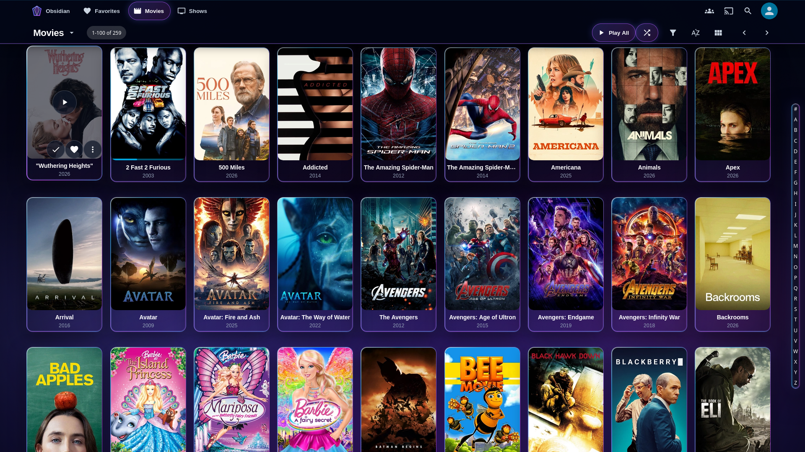
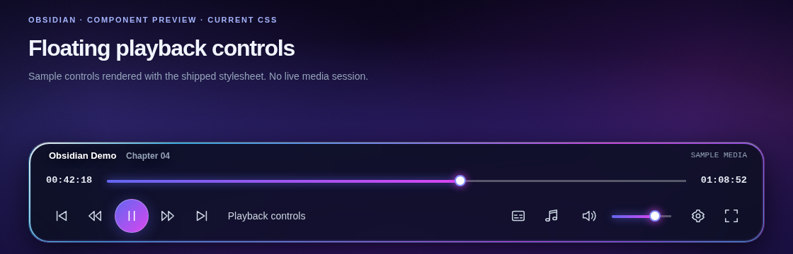

# Getting started with Obsidian

Obsidian changes the appearance of Jellyfin's web interface through Custom CSS. Start with the stylesheet; matching artwork and the navigation companion are optional extras.

[Back to the screenshots and overview](../README.md)

## Install the theme

### Server-wide Custom CSS

1. Sign in to Jellyfin as an administrator.
2. Open **Dashboard → Branding → Custom CSS**. In some versions, Branding is under **General**. Menu labels can vary with your Jellyfin version.
3. Save a copy of anything already in the field so you can restore it later. Other themes may override Obsidian, so try it on its own first.
4. Choose one installation method:

   **CDN import:** paste this before any other CSS rules:

   ```css
   @import url("https://cdn.jsdelivr.net/gh/McEveritts/Obsidian@main/obsidian.css");
   ```

   **Local stylesheet:** open [`obsidian.css`](../obsidian.css), choose **Raw**, copy the entire file, and paste it instead of the import. This avoids the CDN request. The stylesheet itself has no required external font or image URLs; it does not make Jellyfin or your media available offline.

5. Save, return to Home, and reload the page. Use **Ctrl + F5** or **Cmd + Shift + R** if the previous appearance remains.

Custom CSS affects clients that load it. It does not reskin independent native mobile or TV interfaces. Jellyfin Media Player uses an embedded web UI, but its version, settings, and player mode can affect which surfaces receive the styling.

### One client or user only

If your client offers a personal **Settings → Display → Custom CSS** field, use that for a local override. Availability and scope depend on the client/version. If the field is absent, use the server-wide method or your client's documented CSS mechanism. Avoid importing the theme twice through both settings.

### Choose an update policy

- **Follow development:** the `@main` import follows the main branch, subject to CDN and browser caching. Changes may not appear immediately after a GitHub push.
- **Keep a fixed snapshot:** replace `main` in the URL with a full Git commit SHA from the [history](https://github.com/McEveritts/Obsidian/commits/main/). Update that SHA when you want a newer version.
- **Manage updates yourself:** paste the full stylesheet and replace it manually when needed.

The `v2.0.0` tag exists, but it is an older snapshot than the current main branch. Pinning that tag does not include later controller and component fixes.

## Take a first-run tour

### 1. Browse Home and your libraries

Open Home. Your existing libraries, Continue Watching, and recently added rows use glass-edged cards over a dark aurora background. On a desktop with a mouse, hover a card to see its lift and highlight. With a keyboard, move focus to see the focus styling.

On touch devices, swipe horizontal media rows. Open a library to browse its poster grid; compact portrait layouts use smaller grids. Library contents, sorting, and filtering continue to come from Jellyfin.

[](./screenshots/03-desktop-library-grid.png)

### 2. Open an item

Select a movie or episode. Its poster, metadata, track selectors, and playback actions sit on a dark glass panel. Choose your audio/subtitle options and use Jellyfin's normal **Play** or **Resume** action. Available options depend on the item and client.

### 3. Use the player

During playback, reveal the controls using your client's normal pointer, touch, or remote interaction. Obsidian styles the timeline and transport controls as a floating dock. Volume, subtitle sync, chapter previews, playback statistics, and Up Next have matching surfaces when Jellyfin displays them.

Obsidian styles these controls; your client and server still determine playback capabilities, codecs, transcoding, and stream quality.

[](./screenshots/playback-controls-preview.png)

This is a component preview rendered from the shipped stylesheet with sample markup, not a live playback screenshot. [More player previews](./gallery.md#playback-controls).

### 4. Tune the look for your device

Open [Presets](./presets.md) and append your chosen snippet **after** the import or full stylesheet:

| Choice | What changes |
| :--- | :--- |
| Default | Static aurora with full glass surfaces. No extra snippet needed. |
| Balanced | Lower blur and atmosphere intensity, no grain, gentler card lift. |
| Lite | Removes backdrop blur and atmosphere layers, with more opaque surfaces. |
| Animated aurora | Opts into a slow background animation. Reduced-motion preferences take priority. |
| Accent colors | Replaces the indigo/fuchsia highlights with another palette. |

Save and refresh after changing presets. Choose one performance configuration at a time; restore the default by removing its override snippet. Actual rendering performance varies by device.

See the [current gallery](../README.md#screenshots) and [capture notes](./screenshots/README.md) for verified images. [Verification](./verification.md) distinguishes recorded live checks from browser fixtures.

## Add the matching covers

The [cover pack](../assets/covers) includes Movies, Shows, Live TV, Collections, Music, and Playlists at 1920 × 1080.

[**See all six covers and download the originals →**](../assets/covers/README.md)

1. Open a cover's file page and use **Download raw file** to save the PNG.
2. In Jellyfin, open the target library/item's **… → Edit images** menu as an administrator. For a library, this may also be available through **Dashboard → Libraries**.
3. Upload it as the **Primary** image, replacing the existing primary artwork if needed.
4. Save and reload Home.

Only apply artwork to entries that expose an image editor. Built-in shortcuts may not offer editable images in every version. The pack is optional and does not replace your movie/episode posters. The theme does not upload covers for you.

## Optional controller and keyboard companion

Install this only if you administer the Jellyfin Web files. The CSS already provides focus styling; [`obsidian-xbox-nav.js`](../scripts/obsidian-xbox-nav.js) adds handling for particular menu and modal behaviors.

1. Back up Jellyfin Web's `index.html` and any existing customization.
2. Copy [`scripts/obsidian-xbox-nav.js`](../scripts/obsidian-xbox-nav.js) into the directory containing that `index.html`, or the web-directory overlay used by your deployment.
3. Insert the following immediately before `</body>`:

   ```html
   <script defer="defer" src="obsidian-xbox-nav.js"></script>
   ```

4. Reload the web client. If you use a container or web-directory overlay, make sure the file and index edit persist through your deployment process. A Jellyfin upgrade may replace them.

<details>
<summary><b>Optional: persist across Debian/Ubuntu apt upgrades</b></summary>

On Debian and Ubuntu package installations (`/usr/share/jellyfin/web`), `apt` upgrades of `jellyfin-web` replace `index.html`. Because `DPkg::Post-Invoke` runs as `root`, install both the companion script and [`scripts/ensure-obsidian-jellyfin-web.sh`](../scripts/ensure-obsidian-jellyfin-web.sh) into root-owned system paths rather than referencing a user home directory:

1. From a local Obsidian checkout, install the root-owned files and run the helper once:

   ```bash
   sudo install -m 0644 -o root -g root scripts/obsidian-xbox-nav.js /etc/jellyfin/obsidian-xbox-nav.js
   sudo install -m 0755 -o root -g root scripts/ensure-obsidian-jellyfin-web.sh /usr/local/sbin/ensure-obsidian-jellyfin-web
   sudo /usr/local/sbin/ensure-obsidian-jellyfin-web
   ```

2. Register an APT post-invoke hook so `jellyfin-web` upgrades re-apply the companion automatically:

   ```bash
   sudo tee /etc/apt/apt.conf.d/99-obsidian-jellyfin-web >/dev/null <<'EOF'
   DPkg::Post-Invoke { "if [ -x /usr/local/sbin/ensure-obsidian-jellyfin-web ]; then /usr/local/sbin/ensure-obsidian-jellyfin-web || true; fi"; };
   EOF
   sudo chmod 0644 /etc/apt/apt.conf.d/99-obsidian-jellyfin-web
   ```

3. To update the companion later, copy the new file to `/etc/jellyfin/obsidian-xbox-nav.js` and re-run the helper:

   ```bash
   sudo install -m 0644 -o root -g root scripts/obsidian-xbox-nav.js /etc/jellyfin/obsidian-xbox-nav.js
   sudo /usr/local/sbin/ensure-obsidian-jellyfin-web
   ```

4. To remove the companion and APT hook completely:

   ```bash
   sudo /usr/local/sbin/ensure-obsidian-jellyfin-web --remove
   sudo rm -f /etc/apt/apt.conf.d/99-obsidian-jellyfin-web \
     /usr/local/sbin/ensure-obsidian-jellyfin-web \
     /etc/jellyfin/obsidian-xbox-nav.js
   ```

</details>

| Situation | Companion behavior |
| :--- | :--- |
| Open a supported popover with keyboard/TV navigation | Moves focus into its first visible usable control when appropriate. |
| Select a view-menu entry | Makes MUI menu items focusable and handles Enter, Space, or Jellyfin's GamepadA key event. |
| Press Back/B with a supported MUI overlay open | Dismisses the overlay instead of navigating out of the library. |
| Use Up/Down in desktop filter/view popovers | Moves focus between usable controls. |

These behaviors depend on your client emitting the corresponding Jellyfin keyboard/controller events. The script does not add general gamepad support or change every remote button. Test the target client; the automated navigation suite uses browser fixtures rather than physical Xbox/TV hardware.

To remove the companion, remove its script tag, then its copied JavaScript file, and reload. You can keep the CSS installed.

## Troubleshooting

| Symptom | What to check |
| :--- | :--- |
| Nothing changes | Confirm you saved the correct Custom CSS setting and that the client loads server CSS. Keep the `@import` before all style rules. Try pasting the full stylesheet if the CDN is blocked. |
| An old appearance remains | Hard refresh or reload the embedded web client. A pinned SHA/tag stays fixed; `@main` can be cached by the CDN. |
| Some screens clash | Temporarily remove other theme imports and customization. Include the Jellyfin Web version, client, and affected screen in an issue. |
| Scrolling or glass effects are slow | Try Balanced, then Lite. Browser/GPU behavior varies; a 120Hz display alone does not guarantee a 120fps interface. |
| Native TV/mobile app looks unchanged | Independent native interfaces may not use Jellyfin Web or its Custom CSS. Check the client's theming support. |
| Covers still show the previous art | Confirm the new PNG is the target entry's Primary image. Save and reload; some built-in shortcuts do not expose an image editor. |
| Controller menus still behave as before | CSS cannot load JavaScript. Confirm the companion file loads, the script tag survived an update, and the client emits the supported input events. |

When [reporting a problem](https://github.com/McEveritts/Obsidian/issues), include your **server and web-client versions**, **browser/client**, **screen size or device**, **installation method/preset**, and steps to reproduce. Remove server addresses, account names, tokens, and other private details from screenshots or logs.

## Update or uninstall

For a pasted installation, replace the old stylesheet with the new [`obsidian.css`](../obsidian.css), then reapply your preset after it. For a pinned CDN URL, update its ref. For `@main`, allow for CDN caching before expecting a new push to appear.

To uninstall, remove the Obsidian import or pasted stylesheet and its preset overrides from Custom CSS, restore any previous CSS, save, and refresh. Remove the companion separately if installed. Uploaded covers remain until you replace them in Jellyfin's image editor; removing the CSS does not remove artwork.
